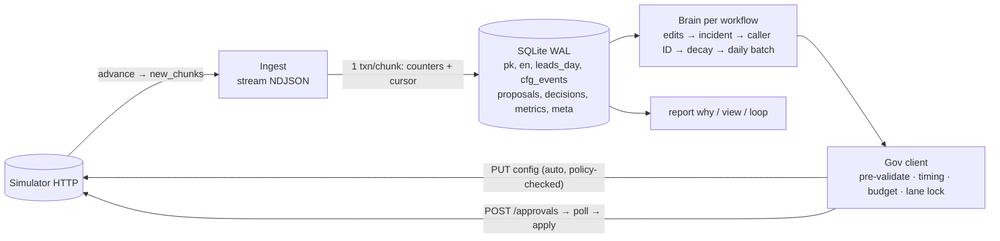

# Outcome-First Agent Loop — Submission

**Name:** Vivek Chauhan · **Date:** 2026-11-09 · **Hours actually spent (be honest):** _[fill in]_ — built in a single-day sprint with an AI pair · **Language / storage:** Python 3.10+ (stdlib + httpx, numpy already in requirements) / SQLite (WAL), one file per scenario under `state/`

---

## 0. TL;DR
- `./run.sh <SIM_URL>` runs a controller that ingests every event chunk into SQLite counters, then for each workflow detects caller-ID degradation and hallucination incidents, runs factorial welcome × voice tests per age-band cohort, sets call-time weights from history, and pushes every change through governance (auto-apply only for operational dims the policy allows).
- **public_01:** conclusion rate **+12.4%** vs baseline (pickup +8.7%, engagement +1.7%), 15 changes applied (8 beneficial, 7 neutral), **0 harmful**. Mean over a 4-seed sweep: +14.3%, 0 harmful (§5).
- **public_02:** conclusion rate **+28.2%**, hallucinated calls **185 vs 431**, supervisor's bad prompt fixed in **150 min** (validated revert, approved by the client), flagged caller ID rotated out the same day. 19 changes, **0 harmful**. Mean over a 5-seed sweep: +27.7%, 0 harmful.
- **public_03 load:** conclusion **+21.9%** across 12 workflows, 61 changes, **0 harmful**; ~13 s wall per simulated day (budget: 10 min), 215k events/s ingest, 47 MB peak RSS (§8).
- Survives `kill -9` at random points: 8 kills in one public_02 run, finished correctly (+29.0%, 0 harmful), no double-apply, no lost approval (`reports/crash_test_public_02_incidents.log`).
- How to run, debug and extend: [docs/CONTROLLER.md](docs/CONTROLLER.md).
- **Not built:** per-person call time, prompt experimentation, a UI, cross-tenant credit fairness.

## 1. Assumptions
1. `guardrail.*_max_drop: 0.02` is read as **relative** 2% (stricter of the two readings).
2. Lead features are stable per `person_id`. A person's segment is set on every `lead` event and re-used for returning people.
3. Age band drives *when* people pick up (morning/lunch/evening). That's a hypothesis checked against history (first-attempt pickup by age × hour), not a constant baked in. If history shows no hour pattern for a cohort, its weights come out flat.
4. A supervisor edit expresses ownership. A dimension a supervisor touched gets no controller changes for 48h, and any experiment on it stops for the rest of the run.
5. The incident that matters for hallucination is a prompt change. Prompt is the only lever with a hallucination rate, so "revert to a prompt that ran clean in production" is always a candidate fix.
6. Validation pass rate measures safety only. It never counts as evidence of engagement.
7. Approver budget, set voluntarily below policy: at most `min(2, max_requests-1)` routine requests per workflow per 24h, nothing in the approvers' first hour (Kestrel asked for "never before 11:00"). The remaining slots are reserved for incidents and rollbacks.
8. The simulator's clock is authoritative. If its state is *behind* our stored minute, it's a new world, and old state is moved aside rather than replayed.
9. Hidden scenarios share the schema and the simulator code but not the truth. So all thresholds are statistical rules over observed data. No scenario constants (DID health, effect sizes, archetype tables) appear in the controller.

## 2. Scope decisions
| # | Capability | Built / Partial / Cut | Why | What it would take to finish |
|---|---|---|---|---|
| C1 | Ingestion | **Built** | Floor and load. Streamed NDJSON, one SQLite txn per chunk incl. cursor | Partition by workflow for 10× (§8) |
| C2 | Shared cohort object | **Built** | Age-band cohorts used by schedule, allocations, read-outs, supervisor view. Counters keyed by atomic segment (age × tier), so any cohort is a sum | Add lang/value to the segment byte once a cohort needs them |
| C3 | History bootstrap | **Built** | Call-time model, DID baselines, hallucination flag baseline all come from history | — |
| C4 | Call-time optimisation | **Partial** (per cohort) | Big pickup lever, safe (no engagement risk). Per person cut: most people have ≤ 8 attempts and few pickups, so it's noise | Per-person only for returning people with a past pickup hour |
| C5 | Caller-ID health | **Built** | Biggest pickup lever: even load spread + flag detection + small probes of unknown DIDs | Re-probe flagged DIDs on a slow schedule |
| C6 | Welcome × voice experiments | **Built** | Independent per-dial randomisation = free factorial. Fast drop, slow promote, cohort veto | Thompson sampling once harm accounting allows bigger arms |
| C7 | Promotion, decay, rollback | **Built** | 30% holdout after promotion; daily champion-vs-holdout check with persistence; novelty guard before promotion; rule chosen by seed sweep | Sequential test with winner's-curse correction (§13) |
| C8 | Hallucination response | **Built** | Validate supervisor prompt immediately; flag-rate Poisson test; revert to known-good via approval; verify | — |
| C9 | Governance client | **Built** | State machine, local pre-validation, timing vs TTL, reserve slots, stale re-propose, crash reconcile | Smarter batching across days |
| C10 | Impact / affected / dry run | **Partial** | Honest but simple (§6) | Off-policy replay with confidence intervals |
| C11 | Supervisor view | **Partial** | `python -m controller.report view`, one screen per workflow from the audit store | Web page on top of the same query |
| C12 | Audit store + "why" | **Built** | `decisions` + `proposals` + `cfg_events` tables; `report why` | — |
| C13 | Crash recovery demo | **Built** | `scripts/crash_test.sh` (random `kill -9` loop + consistency check) | — |
| C14 | Loop observability | **Partial** | `metrics` table + `report loop` (ingest rate, decide time, RSS, credits, decisions) | Push metrics to Prometheus; paging rules (§10) |
| C15 | Fair credits/attention across tenants | **Cut** | Credits barely used (5 of 200 in public_02). Approver budgets are already per workflow | Per-tenant credit buckets with incident priority |

**Principle:** build what moves hidden-scenario outcomes without risking harm (caller ID, call time, incidents), plus everything that's non-negotiable (governance, audit, crash safety, throughput). Variant experiments come last among the built pieces: they carry the most harm risk per unit of lift.

## 3. Stakeholders

### 01 — Sales (Nikhil)
- **Accepted:** speed where it's safe. Operational fixes (caller-ID rotation, call time) auto-apply within policy in minutes. One approval request per workflow per day bundles everything.
- **Declined:** one blended score (Product and the README both forbid it; we report pickup, engagement and conclusion separately). "Winning by lunch → live by evening" (one morning is ~100–200 connects per arm; that produces false winners, and both public scenarios have a winner that decays within days). Rolling out the "persuasive" prompt (P4 hallucinates ~4× the production prompt).
- **Wrong claims:** *"Kestrel turned on auto-apply for everything"* is false. `ks_cancel` auto-apply covers schedule/caller_id/welcome/voice with `max_shift 0.2`, and never the prompt. *"Northwind is fine with auto-apply on KYC"* is false. `nw_kyc` has auto-apply **disabled**, and Northwind's Compliance head requires human approval for anything customer-facing.
- **Reply:** "Nikhil — we'll have per-client lift numbers for the summit: pickup, engagement and leads concluded, each shown separately, since that's the product definition and what clients' compliance teams sign. Operational wins (caller IDs, call timing) already go live within the hour. Customer-facing wins go to the client's approver in one daily request, after enough calls to trust them; in our tests one 'winner' faded within three days and we rolled it back. Kestrel's auto-apply doesn't cover scripts, and Northwind KYC has no auto-apply at all, so we can't push straight through there. The persuasive script hallucinates ~4× more; not something to demo to insurers."

### 02 — Client Compliance (Meera, Northwind)
- **Accepted, all of it:** every customer-facing change (welcome, voice, prompt) goes through a named approval. Prompt changes carry a `validation_run_id`. Requests only go out in approver hours, and never when they would expire in the queue overnight. "Why did this customer hear X" is answered from our store (`report why`, plus the call's `config_version` → proposal → approval).
- **Pushed back:** none on principle. We added a voluntary limit: one routine request per workflow per day, with spare slots kept for incidents.
- **Wrong claim:** *"call timing and caller-ID rotation are covered by the policy we signed"* is true for **renewal** only. `nw_kyc` has auto-apply disabled, so KYC timing and caller-ID changes also go through approval.
- **Reply:** "Meera — agreed on all five points. Every change to what a customer hears needs your approver's sign-off, and script changes carry a validation run ID. We answer 'what did this customer hear and why' from our own audit store in minutes, not 24 hours. One correction for your records: the operational latitude in your policy covers the renewal workflow only. KYC has no auto-apply, so even timing and caller-ID changes there come to your approvers. Requests only go out between 11:00 and 18:00, so nothing waits overnight. Operational changes on renewal will be listed in the weekly summary."

### 03 — Platform/SRE (Kabir)
- **Accepted:** kill/restart test (§9), idempotency via deterministic proposal IDs + reconcile on start, no new infrastructure (SQLite here, Postgres in production), loop health without logs (`report loop`, `metrics` table).
- **Pushed back:** nothing. Measured **~15 s wall per simulated load day** against your 10-minute budget.
- **Reply:** "Kabir — kill/restart is tested: `scripts/crash_test.sh` kills the controller at random points (8–10 kills per run) and checks nothing was applied twice or lost. Every write to the client uses a deterministic proposal ID, written before the call and reconciled on startup. No new stateful infra: one SQLite file locally, Postgres in prod, no Redis. On public_03 a full simulated day takes ~15 s wall including the simulator; ingest ~180k events/s. At 10× the first thing to go is the single process; plan in §8. Paging list in §10: only incident-unfixed, ingest stalled, and credits low page."

### 04 — Client Ops Supervisor (Anita, Kestrel)
- **Accepted:** we never silently undo her edits: dimensions she touches are hands-off for 48h and experiments on them stop. Max 2 routine requests/day, none before 11:00. One request bundles all changes. One screen (`report view`).
- **Pushed back:** one exception on safety. When her prompt edit fails validation (P2 in public_02: pass rate 0.935, flags ~4× baseline) we *ask* her approver to revert, with evidence, the same day. We never revert without approval. We avoid "fixes" that kill engagement: the incident fix prefers a prompt with real engagement history over the strict compliance script.
- **Reply:** "Anita — we won't touch anything you change: if you edit a voice or prompt, we stop testing that dimension, and our pending requests get re-based on your version. You'll get at most two requests a day, never before 11:00, each bundling everything. The one exception is safety. If a prompt edit starts hallucinating, we send one request with the validation result and ask to revert; it only happens if you approve. Your one screen: what's tested, what's winning, what's waiting on you, what changed today. And no word-for-word compliance script: validation only checks safety, so we prefer scripts that have already held calls in production."

### 05 — Product (Tara)
- **Accepted:** separate KPIs everywhere. One cohort object (age-band cohorts, same IDs in config, read-outs and view). Every proposal carries impact, diff, affected leads and a dry run. An expired proposal = rejection, re-planned with fresh data under a new ID. Only arms that actually ran count (read-outs use the `variant` and `config_version` recorded on each call, never the intended allocation). Winners stay inside their workflow.
- **Minimum size / window (her open question):** ≥150 connects per arm to *drop* a loser at z < −2, ≥300 to *promote* at z > 2.8 with ≥3% lift *and* the winner still ahead in the last 2 days. Cost: detecting a +10% lift takes ~2–3 days per workflow at ~1,000 connects/day; a true −10% arm is dropped in ~1–2 days.
- **Pushed back:** per-person call time is not P0. A person has at most 6–8 attempts and a handful of pickups, so a per-person preferred hour is mostly noise, and the 0.25× penalty for every other hour can starve them. Per-cohort timing is what's built.
- **Reply:** "Tara — held to all definitions; KPIs are never blended. On cohort size: we drop a losing arm at ≥150 connects (fast to stop harm) and promote only at ≥300 with strong significance and a still-winning last two days. That costs 2–3 days per decision but avoids novelty winners; one faded within three days in testing. Impact score = expected relative change in the primary KPI ÷ 10%, capped at 1. Per-person call time I've deprioritised: the data per person is too thin, and per-cohort timing captures most of the gain without starving anyone. Caller-ID health and the supervisor view are in."

### 06 — CTO (Aryamann)
- **Accepted:** choosing, written down (§2). Spend credits only where they change a decision: 5 credits in public_02, and the LLM is never called when a known-good prompt passes validation. Explainability first: every change has a stored rationale, evidence, approver and follow-up.
- **Memo contradictions caught:** Sales on Kestrel/Northwind auto-apply; Compliance on KYC latitude; Anita's 11:00 limit is stricter than her own policy (10:00), so we accepted the stricter one.
- **Reply:** "Aryamann — I chose caller-ID health, call time, incident response and governance first: large and safe lift, no customer-facing risk. Experiments come after, with a 'fast to drop, slow to promote' rule and holdouts to catch decay. I said no to per-person call time, prompt A/B tests, a UI and cross-tenant credit fairness, and wrote down why. On load a simulated day takes ~15 s; at 10× the single process breaks first; partitioning plan is in §8. Known weak spot: one false rollback in public_02 from winner's curse; fix described."

## 4. Architecture



- **Counters, not events.** `pk(wf, day, hour, segment, caller_id, first_attempt) → dials, connected` and `en(wf, day, hour, segment, welcome, voice, prompt, config_version) → connected, engaged, flags`. Segment = age × tier, one byte per person (`segmap` blob per workflow). Every detector is a GROUP BY over these.
- **Brain state** (experiments, records, flagged DIDs, incidents) is JSON in `meta`, saved after each step. Plans are tagged with their deterministic proposal ID *before* sending.
- **Restart:**
  1. Open the DB (move it aside if it belongs to another world).
  2. `gov.reconcile()`: every `intent` row is looked up on the server, auto ones in `/config/history` and approvals in `/approvals`.
  3. Ingest chunks after the cursor.
  4. Poll pending approvals and apply any that were approved.
  5. Continue from `/sim/state`.
- **Ticks:** 15 min during dialling/approver/apply hours, one jump overnight.

## 5. The learning loop
- **Cohorts:** four age bands. Age is what history shows driving pickup-by-hour, and it's where engagement effects most plausibly differ. Four cohorts keeps ~250 connects/cohort/day on a small workflow. Statistics pool across cohorts that share an allocation, so traffic isn't fragmented: pooled main effects decide, and cohorts only veto or need stronger evidence.
- **Experiment design:**
  - Welcome and voice are randomised independently per dial, so every call informs both tests (a factorial design, analysed by main effects; the response model is multiplicative, so interactions are second-order).
  - The incumbent keeps ≥55% and each challenger gets ≤15%. Why so small: every config change is judged at apply time, and a 15% arm that is 10% worse costs only 1.5% expected engagement.
  - Exploration starts with the first daily approval.
- **Winner selection** (deterministic, two-proportion z-tests):
  - **Drop** if n ≥ 150 and z < −2 (fast to stop harm).
  - **Promote** if n ≥ 300, z > 2.8, lift ≥ 3%, and still ahead in the last 2 days (novelty guard).
  - **Cohort-only promotion** needs n ≥ 150, z > 3.0, and the same novelty guard on *that cohort's* last 2 days. Two lessons from the seed sweep: without the guard, a fading W3 was promoted for one cohort a day after the pooled check had held it (a harmful change in the crash run). With the guard read *pooled*, a real cohort-specific winner (KYC V2 for ages 46+) was diluted by cohorts where it does nothing, and KYC engagement fell. Hence a cohort-level read.
  - **Cohort veto** on promotion if the winner is worse in that cohort at z < −1.65.
  - Multiple comparisons: z 2.8 ≈ one-sided α 0.0025, roughly Bonferroni over ~5 challengers × daily looks.
  - Expected false-winner rate: < 1 per scenario at these settings. I haven't measured it with A/A splits on history yet (§13).
- **Decay and rollback:**
  - The previous incumbent stays as a **30% holdout**. That's big enough that a 10% decay shows within ~2–3 days on a ~1,000-connect/day workflow.
  - **Once a day**, champion vs holdout over the last 3 days. Roll back if **z < −1.65** *and* yesterday alone also shows the champion below the holdout (persistence, so one bad stretch doesn't trigger it).
  - Why one-sided 5% and not stricter: rolling back a champion that's truly *equal* to its holdout is harmless (scored neutral). Harm needs a truly better champion, whose z sits well above 0. A loose bar costs little and catches decay sooner.
  - Why no "lift fell vs. lift at promotion" test: that baseline is inflated by winner's curse (we promoted *because* it looked good). In the first version it caused a false rollback of a truly positive variant (ks_cancel W2). A version with a shrunk baseline (promotion lift − 1.5 SE) was tested and lost (below).
  - **How the rule was chosen: seed sweep** (`scripts/seed_sweep.sh`; per-seed grade JSONs in `reports/seed_sweep/`). The same public scenarios under 9 different simulator seeds (same truth, different randomness), three candidate rules, scored by the grader:

    | Rule | public_01 (4 seeds) mean conclusion / harmful | public_02 (5 seeds) mean conclusion / harmful | false rollbacks |
    |---|---|---|---|
    | v1: hourly, z<−2 or decline vs promotion lift | +13.9% / 0 | +28.4% / 0 | 1 of 7 rollbacks (V3) on public_02 |
    | **v2: daily, holdout-only, z<−1.65, 3 days, persistence (decay rule kept)** | **+14.7% / 0** | **+29.0% / 0** | **0 of 8** |
    | v3: v2 + shrunk-baseline decline test | +12.8% / 0 | +28.0% / 1 | — |
    | **final: v2 + guardrail monitor + per-cohort novelty guard** | **+14.3% / 0** | **+27.7% / 0** | 0 |

  - Cost of v2: mild decay is caught late. public_01's W3 fades only to 0.93× and v2 often keeps it to the end. public_02's W3 (0.90×) is rolled back D5–D7.
- **Call time:** first-attempt pickup by age × hour from history + live data, shrunk to the cohort mean (50 pseudo-dials). Weight = (rate / cohort mean)², clamped to [0.1, 5]. Every window hour keeps a non-zero weight, so capacity is never idle. Refreshed by auto-apply where schedule is allowed.
- **Caller ID:**
  - Target = even split over healthy DIDs. Dial load degrades a number, so spreading load is the biggest pickup lever (KYC +24% pickup in public_01).
  - Unknown DIDs are probed at 5% (auto workflows) or 10% (approval-only). Healthy = ≥ 300 dials and pickup ratio ≥ 0.85 vs the rest.
  - Flagged when pickup is < 0.65× peers with similar share at z < −3, over 4h or 24h windows. Peers only, so an overloaded DID isn't judged against fresh probes.
  - Flagged DIDs leave in steps of ≤ `max_shift` per tick.
- **Guardrail:** variants only move engagement and timing only moves pickup, so the guardrail is mostly protected by construction. On top of that, a **daily guardrail monitor** (engagement guardrails):
  - **Within-cohort:** expected = live connects per age band × that band's history rate, so a schedule that changes *who* connects doesn't false-alarm. (Measured on KYC: the age-mix effect was −0.2%; the real cause was the W2 arm.)
  - **Noise-aware:** the standard error is the larger of binomial noise and the history's day-to-day spread of the same ratio. Daily lead pools differ: pure-W1 KYC days range 0.54–0.64 (sd 3.9%). A binomial-only first version false-alarmed twice in one run and stopped a test whose challenger was *winning*.
  - **Breach** = 2 full days below the policy limit *and* z < −2. **Action:** only what concurrent evidence implicates (challenger arms behind the incumbent, winners not beating their holdout), via a reserve approval slot. If nothing is implicated, alert only. Pickup guardrails aren't acted on: welcome/voice can't move pickup, and caller-ID drops have their own detector.
  - **Tried and rejected:** "guardrail-only" tests on pickup-primary workflows (10% arms, drop at z < −1). On the seed sweep it cost lift (public_01 +13.0% vs +14.7%) without improving the worst-case KYC engagement (−2.7% both), so it was reverted.

## 6. Governance
- **State machine:** `intent → pending → approved → applied`. Terminal states: `rejected | expired | lapsed | stale | refused | unsent`. Auto path: `intent → applied | stale | refused`.
  - Every terminal-not-applied state reverts the brain's plan, and the next batch re-plans with fresh data under a new proposal ID. An expired proposal counts as a rejection.
  - `stale` (409 on apply after a supervisor edit or our own auto change) leads to a re-plan on the current version.
- **Timing:**
  - Routine requests go out only between approver open + 1h and close.
  - Never when the decision could spill to the next morning beyond the TTL (ks_cancel's 12h TTL would expire a 17:30 request).
  - Approved changes are applied on the next 15-minute tick, well inside the 2h apply window.
  - Lane lock: no non-urgent auto-apply while an approval is pending, so we don't stale our own request.
- **Budget:** routine `min(2, max−1)` per 24h; incidents/rollbacks can use the remainder. Peak requests per 24h in public_02: 2 per workflow. Rejections were only the 5–15% judgement calls; no fatigue, no malformed requests, no lapses, 0 auto-apply 403s (the policy is checked locally first).
- **Auto-apply:** only caller_id and schedule. We **voluntarily** don't auto-apply welcome/voice on Kestrel, although policy allows it: Anita asked to be told before customer-facing changes, and Compliance-style approval is the stronger audit story.
- **Impact score:** expected relative change in the primary KPI at workflow level ÷ 10%, capped at 1. Incidents = 1.0. Routine changes without an estimate get a flat 0.2, so the queue ranks real estimates above them.
  - **Affected leads:** active leads in the cadence window (uploaded − concluded), scaled by the dial share of the affected cohorts.
  - **Dry run:** the exact data the decision used. Arm read-outs with n/engaged/z/lift since the experiment's config version; schedule = per-hour pickup model and an *optimistic* re-split gain estimate (it ignores eligibility depletion, labelled as such); caller ID = 24h pickup per DID.
- **Supervisor edit mid-experiment** (public_02 D5 15:00, voice): logged; voice frozen 48h and the voice experiment stopped for good; our pending batch failed `stale` on apply and was re-planned without voice.

## 7. Incidents
- **Hallucination detection:**
  - (a) On any supervisor prompt change, an immediate validation run of the new prompt (n = 200, 2 credits). Fails if below the workflow's `min_validation_pass_rate`.
  - (b) For any prompt not yet known-good: one-sided Poisson test of flags over the last 6h vs the production prompt's history flag rate. Fires at p < 1e-4 with ≥ 5 flags; false-positive rate per hourly look ≈ 1e-4 by construction.
- **Fix:**
  - Candidates are the previous prompt, then other prompts that ran clean in production. Each is validated at n = 300 (3 credits).
  - The LLM (3 credits) is called only if none passes. Its candidates are also validated.
  - Proposed via approval with `validation_run_id`, using a reserve slot.
- **Verify:** 3h after the fix goes live, the flag rate is tested against the baseline again and logged as `incident_verified` or `incident_not_fixed`.
- **public_02 timeline (ks_cancel):**

| Time | Event |
|---|---|
| D3 11:30 | Supervisor ships P2 |
| D3 11:45 | Next tick: validation of P2 (pass rate 0.935 < 0.97) → incident; P1 validated at 0.99; approval requested |
| D3 14:00 | Approved and applied |
| D3 17:00 | Verified: 1 flag in 296 connects |

  MTTR 150 min, of which ~135 min was approver latency. **Credits:** 5 of 200.
- **Caller ID:** D2 flagged on D2 at 10:00; detected on the 4h window and rotated out in `max_shift` steps by auto-apply. Grader: flagged-DID share 0.086 on the incident day, 0 after.

## 8. Scale (public_03_load, 12 workflows, ~800k events/day)
See `reports/public_03_load_loop.txt` and `reports/public_03_load.md`.

| Metric | Value |
|---|---|
| Whole scenario, wall clock (incl. 38 s simulator history generation) | **136 s** |
| Wall time per simulated day (sim + controller, MacBook) | **~12–15 s** |
| Ingest | **~215k events/s** (9.7M events incl. 7 days history in 45 s) |
| Decide time per tick (12 workflows) | mean 0.05 s, max 0.24 s |
| Decision lag | ≤ 1 tick (15 sim-min): every tick ingests all new chunks before deciding |
| Peak RSS (controller) | **47 MB** (was 1.5 GB before streaming chunk lines instead of loading 250k-line chunks whole) |
| Outcome | conclusion **+21.9%**, pickup +13.1%, engagement +5.0%, 61 changes: 36 beneficial, 25 neutral, **0 harmful** |

**What breaks first at 10× (≈ 8M events/day, ~1,000 workflows):**
1. **Single-process ingest.** ~45 s/day at the same rate is still fine for the simulator, but production is continuous. Partition by `workflow_id` hash across workers, each with its own cursor, writing to Postgres tables partitioned by workflow and day.
2. **SQLite writer lock.** One writer → Postgres.
3. **`segmap` per workflow grows with persons ever seen.** Keep only active leads (cadence window) or move it to a Postgres table keyed by person.
4. **Per-tick config GETs** (one per workflow per tick). Cache config versions and refresh on `config_changed` events.
5. **Approver attention**, not compute, becomes the bottleneck across hundreds of workflows. That's where C15 (fair allocation) starts to matter.

## 9. Reliability
- **Method:** `scripts/crash_test.sh public_02_incidents` restarts the controller in a loop and `kill -9`s it after 0.5–3 s, until a run finishes. Then it compares every server approval against our proposals table and checks `config/history` for duplicate proposal IDs.
- **Result:** 8 kills, run finished, `CHECK PASS` (10 server approvals = 10 local, 0 double-applied). Graded (`reports/crash_public_02_incidents.md`): conclusion +29.0%, 0 harmful, MTTR 150 min, same as the uncrashed run. Log: `reports/crash_test_public_02_incidents.log`.
- **State lost:** none that matters. A kill mid-chunk rolls back that chunk's transaction and it's re-ingested. A kill between POST and DB update is reconciled on start by proposal ID.
  - Validation runs have no idempotency key, so a kill right after one can re-spend 2–3 credits.
- **Idempotency keys:** `proposal_id = {workflow}:{kind}:{sim_minute}` for both approvals and auto-applies. A replay gets `409 duplicate_proposal_id`, which we resolve by lookup.
- **4xx/5xx handling:**
  - Transport errors and 5xx: retried with backoff on idempotent calls.
  - `/sim/advance` is never blindly retried: on failure we re-read `/sim/state` and only re-post if the clock didn't move.
  - 409 stale → re-plan; 410 lapsed → re-plan; 402 out of credits → skip (incident work is allowed down to 0, routine work stops at a 20-credit floor); 403 auto refused → logged (never seen: pre-checked).

## 10. Audit & observability
```
$ python -m controller.report why --db state/public_02_incidents.db --workflow ks_cancel --at "D3 14:30"
# ks_cancel at D3 14:30: config v9, applied D3 14:00 by the controller
proposal ks_cancel:incident:5025 (incident) via approval apr_00010 (client approver)
summary   : Hallucination incident: revert prompt P2 -> P1 (validated 0.99)
rationale : supervisor prompt P2 validation pass rate 0.935 < 0.97. P1 passes validation and ran in production before without elevated flags.
diff      : {"prompt_version": {"old": "P2", "new": "P1"}}
impact 1.0 · affected leads 3167 · evidence {'validation_run_id': 'val_00002'}
## decision log around it
D3 11:45  supervisor_edit      v8 changed ['prompt_version']; not reverting …
D3 11:45  validation_run       P2 n=200 pass_rate=0.935 (2 credits)
D3 11:45  incident_detected    supervisor prompt P2 validation pass rate 0.935 < 0.97
D3 11:45  validation_run       P1 n=300 pass_rate=0.99 (3 credits)
D3 11:45  approval_requested   incident apr_00010: …
D3 14:00  approval_applied     apr_00010 -> v9 dims=['prompt_version']
D3 17:00  incident_verified    P1: 1 flags / 296 connects since fix (baseline 0.0152)
```
"What did customer X hear on day D": the call event's `config_version` → `proposals.applied_version` → rationale and approver.

- **Supervisor screen:** `python -m controller.report view --db … [--workflow …]`.
- **Loop health:** `python -m controller.report loop --db …`.
- **Page on:**
  - an incident detected but not fixed within 4h (or `incident_no_fix`);
  - ingest stalled (no new chunk for 3 ticks while the sim advances);
  - credits < 20 with an incident open;
  - repeated `refused` / `auto_apply_failed` (a contract mismatch).
  - `guardrail_no_action`: a guardrail breach that no running experiment explains (something outside our changes is hurting customers).
- **Don't page on** (morning summary): rejections, expiries, stale re-proposals, caller-ID rotations that succeeded, decay rollbacks, routine experiment moves, `guardrail_breach` that we already acted on.

## 11. Results
**public_01** (`reports/public_01_dev.md`)

| workflow | conclusion Δ | pickup Δ | engagement Δ | gap captured |
|---|---|---|---|---|
| ks_cancel | +11.4% | +5.7% | +3.9% | 19% |
| nw_kyc | +26.0% | +22.8% | +0.3% | 10% |
| nw_renewal | +5.9% | +5.2% | −0.8% | 2% |
| **ALL** | **+12.4%** | **+8.7%** | **+1.7%** | 11% |

15 changes applied: 8 beneficial, 7 neutral, **0 harmful**. 0 credits used (no incidents). Seed sweep mean: +14.3%.

**public_02** (`reports/public_02_incidents.md`)

| | conclusion Δ | pickup Δ | engagement Δ | hallucinated calls |
|---|---|---|---|---|
| ks_cancel | +54.4% | +38.8% | +5.8% | 89 vs 348 |
| nw_kyc | +27.1% | +28.6% | −2.5% | 36 vs 29 |
| nw_renewal | +9.3% | +12.6% | −3.3% | 60 vs 54 |
| **ALL** | **+28.2%** | **+25.9%** | **−0.3%** | 185 vs 431 |

19 applied: 14 beneficial, 5 neutral, **0 harmful**. MTTR 150 min. Credits used: 5. Seed sweep mean: +27.7%, 0 harmful.

**Interpretation:**
- **Where we helped:** most of the lift is pickup, from caller-ID load spreading (the default config piles all KYC traffic on one number) and flagged-DID rotation. Call time adds a little. Engagement lift is modest: arms are small by design, so promotions arrive on D2–D4.
- **Where we were harmful:**
  - (1) First version, public_02 ks_cancel W2: promoted D3 on +6.5% lift, then rolled back D5 by a false decay alarm. The promotion lift was inflated by winner's curse, and hourly looks multiply the chances of a bad stretch. Fixed by the daily holdout-only rule above; 0 false rollbacks across the 9-seed sweep.
  - (2) Earlier iterations had harmful caller-ID probes and an exploration restart after a supervisor edit. Both fixed in commit `dd782c3`.
- **nw_kyc engagement and its 2% guardrail.** KYC's primary is pickup (+20–30%). Its engagement (the guardrail) moved −4.7% in one run. Diagnosis from our own store: age-mix effect −0.2%; the rest came from the W2 arm (truly 0.92×, 0.529 vs 0.588 on 756 connects), which stayed at 15% until D9 because KYC changes only reach new campaigns and approvals are capped at 2/day. Across the seed sweep, KYC engagement averages about −1% with a worst case of −2.7%. Single-run comparisons carry about ±2% noise (3.9% daily spread, 10 days, two independent runs), so a −2% to −3% reading in one run isn't by itself evidence of harm. The guardrail monitor (§5) is the backstop for a real, large breach; it never fired across the 9 sweep runs. nw_renewal engagement (primary) is slightly negative in some runs because W3 decays mildly; see §5 on late mild-decay detection.
- **Engagement gap captured is low (16–24% on dev scenarios, 32% on load).** Exploration arms are capped at 15% and cohort-specific effects need many days. I chose this deliberately (harm > speed), but it's the main headroom left.

## 12. Trade-offs & rejected alternatives
| Option | Why considered | Why rejected / what instead |
|---|---|---|
| Thompson sampling bandit | Faster convergence | Shifts allocation every tick → many config changes, each judged and each needing approval on most workflows. Batched daily z-test decisions instead |
| Uniform exploration | Max power | One bad arm at 33% costs >1% expected engagement → a harmful change. Capped arms at 15% |
| Fine cohorts (age × lang × tier) | Catch narrow effects | ~250 connects/cohort/day on small workflows; nothing would ever reach significance. Age-band cohorts + segment counters so finer cuts can be added later |
| Keep raw events | Re-analysis | 850k events/day; counters by segment are enough for every query we run, and ~1000× smaller |
| Postgres/Redis locally | Production parity | SQLite = zero ops for the grader's box; same schema ports to Postgres |
| LLM first on incidents | "Detect → LLM suggest" flow | A known-good prompt is cheaper (0 LLM credits) and has real engagement history; LLM kept as fallback |
| Auto-apply welcome/voice on Kestrel | Policy allows it | Supervisor asked to be told first; approval gives a named human in the audit trail |
| Decay rollback vs. promotion lift (also with shrunk baseline) | Catches mild decay fast | Winner's curse → false rollbacks; shrunk version lost the seed sweep (§5). Holdout-only daily test instead |
| Per-person preferred hour | Product's headline | Too few observations per person; the 0.25× off-hour penalty can starve leads |

## 13. Known weaknesses
1. **Mild decay is caught late.** The daily holdout test needs the champion to fall clearly *below* its holdout. A winner that fades to slightly below (public_01 W3, 0.93×) can stay live for days. Next step: an always-valid sequential test (mSPRT) on the champion-minus-holdout stream since promotion, which lets us look more often without inflating false rollbacks.
2. **No A/A measurement** of the false-winner rate. It should come from shuffling arm labels in history and running the decision rule.
3. **Exploration arms aren't decay-checked.** A challenger that decays while still at 15% (W3 in public_01 stays at ~15% all run) is only caught if it trips the drop rule.
4. **Flagged DIDs are permanent.** An overloaded but healthy DID can be mis-flagged when peers are much fresher. The peer-share rule reduces this but doesn't remove it.
5. **Guardrail protection is a backstop, not a fine control.** The monitor needs a drop beyond both the limit and normal day-to-day noise (≈ −5.5% on KYC over 2 days), so a slow −2% to −3% guardrail drift isn't caught. Tighter control needs lower-noise baselines: a concurrent holdout of the pre-experiment config, rather than comparing against history.
6. **Schedule gain estimate is optimistic** (ignores eligible-pool depletion). Labelled so in the dry run.
7. **The supervisor's default change doesn't override our cohort-level winners.** If a supervisor changes the default voice after we promoted a voice per cohort, our cohort override still applies to those cohorts. It's visible in `report view`, but we should ask instead.
8. **Single process.** No partitioning yet (§8).

## 14. If this went to production at Formi next month
1. **Week 1:** run in shadow mode on 3 live workflows (decisions logged, nothing applied). Compare its incident detections and caller-ID flags with what ops saw. Run the A/A false-winner measurement on real history.
2. **Week 1:** move the store to Postgres (same schema, partitioned by workflow/day). Add Prometheus metrics for the paging rules in §10, plus a runbook per alert.
3. **Week 2:** turn on caller-ID rotation and call-time auto-apply where policy allows (safe, operational). Send the weekly summary Compliance asked for.
4. **Week 2:** enable approval-path experiments on one consenting workflow, with the mSPRT rollback fix and per-cohort guardrail rollback.
5. **Then:** partition workers by workflow hash; add per-tenant credit and approver-attention budgets (C15).
